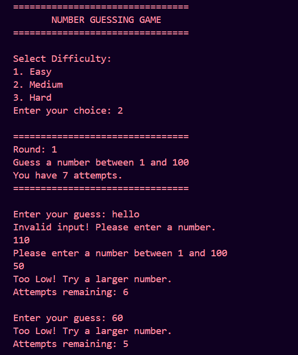
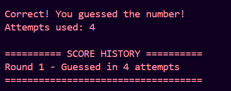
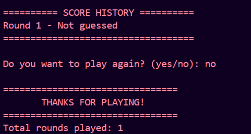

# Number Guessing Game 

## Project Description

The Number Guessing Game is a console-based Java application developed as part of the Oasis Infobyte Java Development Internship.

The computer randomly generates a secret number, and the player must guess it within a limited number of attempts.

## Features

-> Random number generation
-> Three difficulty levels
-> Too High and Too Low hints
-> Limited guessing attempts
-> Win and Lose messages
-> Play Again functionality
-> Score history across multiple rounds
-> Input validation

## Difficulty Levels>

| Level | Range | Attempts |

| Easy  | 1–50  |    10    |
| Medium| 1–100 |     7    |
| Hard  | 1–200 |     5    |

## Technologies Used

-> Java
-> Scanner
-> Random
-> ArrayList
-> Loops
-> Conditional Statements
-> Switch Case

## How to Run

Compile:

```bash
javac NumberGuessingGame.java
```

Execute:

```bash
java NumberGuessingGame
```

## Developer

Biswayan Chakraborty

## Internship

Oasis Infobyte

Java Development Internship

Task:Number Guessing Game


## Screenshots

### Gameplay


### Game Result


### Score History
