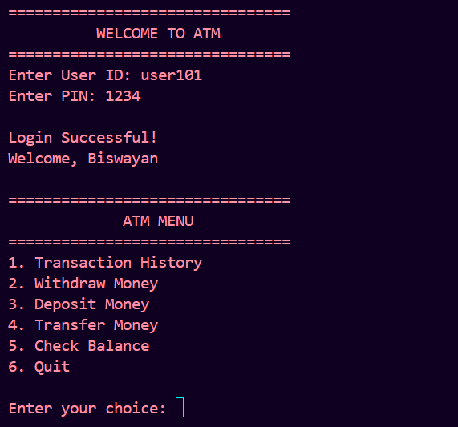
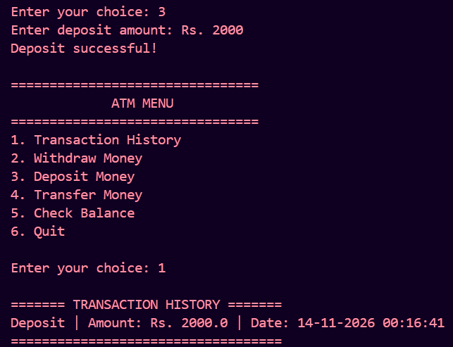
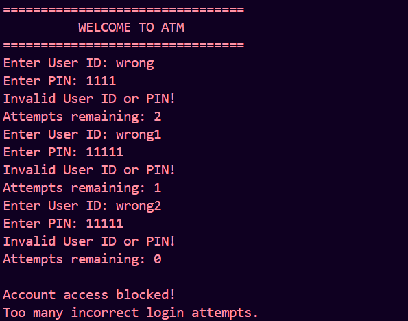

# ATM Interface – Java

## Overview
A console-based ATM Interface developed using Java as part of the Oasis Infobyte Java Development Internship (OIBSIP).

The application simulates basic ATM operations such as user authentication, balance enquiry, cash withdrawal, cash deposit, money transfer, and transaction history.

## Features
-> User authentication using User ID and PIN
-> Account access blocked after 3 incorrect login attempts
-> Check account balance
-> Deposit money
-> Withdraw money with balance validation
-> Transfer money between accounts
-> View transaction history with date and time
-> Menu-driven interface using switch-case

## Technologies Used
-> Java
-> Object-Oriented Programming (OOP)
-> ArrayList
-> Java Date and Time API
-> Scanner class


## Demo Login Credentials

| User ID | PIN | Initial Balance |

| user101 | 1234 | ₹10,000 |
| user102 | 5678 | ₹15,000 |
| user103 | 9999 | ₹20,000 |

## How to Run

1. Clone the repository.
2. Open the project folder in VS Code.
3. Open the terminal in the project directory.
4. Compile the Java files:

```bash
javac Main.java ATM.java Account.java Transaction.java Bank.java
```

5. Run the application:

```bash
java Main
```

## Developer

Biswayan Chakraborty

## Internship

Oasis Infobyte

Java Development Internship

Task: ATM Interface - Java

## Screenshots

### ATM Menu


### Transaction History


### Login Security


## Note
This is a demonstration project. Account balances and transaction history are stored in memory and reset when the application is restarted.


